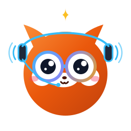
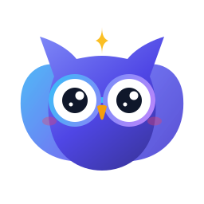

<p align="center">
  
</p>

<h1 align="center">OpenAssist</h1>

<p align="center">
  <strong>The 100% Free &amp; Open-Source Digital Assistant and Circle to Search for Android</strong>
</p>

<p align="center">
  <a href="https://github.com/openassist/openassist/actions"></a>
  <a href="LICENSE"></a>
  <a href="#privacy--security-guarantee"></a>
  <a href="#on-device-whisper-speech"></a>
  <a href="#universal-compatibility"></a>
  <a href="#zero-lock-in-universal-ai"></a>
</p>

---

<p align="center">
  
  &nbsp;&nbsp;&nbsp;&nbsp;&nbsp;&nbsp;&nbsp;&nbsp;
  
  &nbsp;&nbsp;&nbsp;&nbsp;&nbsp;&nbsp;&nbsp;&nbsp;
  
  &nbsp;&nbsp;&nbsp;&nbsp;&nbsp;&nbsp;&nbsp;&nbsp;
  
  &nbsp;&nbsp;&nbsp;&nbsp;&nbsp;&nbsp;&nbsp;&nbsp;
  
  &nbsp;&nbsp;&nbsp;&nbsp;&nbsp;&nbsp;&nbsp;&nbsp;
  
  &nbsp;&nbsp;&nbsp;&nbsp;&nbsp;&nbsp;&nbsp;&nbsp;
  
</p>

---

## 📖 Table of Contents

- [🌟 Why OpenAssist?](#-why-openassist)
- [✨ Key Capabilities](#-key-capabilities)
- [🦊 Meet the Mascot Companions](#-meet-the-mascot-companions)
- [🎯 Interactive Circle to Search](#-interactive-circle-to-search)
- [🎙️ On-Device Whisper &amp; Voice Engines](#-on-device-whisper--voice-engines)
- [🌐 Zero Lock-In: Universal AI Connectivity](#-zero-lock-in-universal-ai-connectivity)
- [🛡️ Privacy &amp; Security Guarantee](#-privacy--security-guarantee)
- [📱 Universal Device Compatibility](#-universal-device-compatibility)
- [🚀 Quick Setup Guide](#-quick-setup-guide)
- [🏗️ System Architecture](#-system-architecture)
- [💻 Building from Source](#-building-from-source)
- [❓ Frequently Asked Questions](#-frequently-asked-questions)
- [📜 License &amp; Community](#-license--community)

---

## 🌟 Why OpenAssist?

OpenAssist is a modern, transparent, and completely free digital assistant designed for anyone who values **control, privacy, and flexibility** on Android. 

Whether you are running a community privacy ROM or stock device firmware, OpenAssist provides an effortless screen-search and voice experience directly integrated with the Android operating system—with **zero tracking**, **zero account lock-in**, and **complete freedom to choose your AI backend**.

```
  ┌───────────────────────────────────────────────────────────────────────────┐
  │                           THE OPENASSIST PROMISE                          │
  ├───────────────────────────────────────────────────────────────────────────┤
  │  ✓ 100% Free & Open Source under the GNU General Public License v3        │
  │  ✓ No telemetry, no usage tracking, no remote logging, no hidden analytics │
  │  ✓ Complete freedom: use any cloud AI or your private home Ollama server  │
  │  ✓ Fully offline speech transcription via embedded C++ Whisper (GGML v2)  │
  │  ✓ Sub-millimeter visual precision with 8-handle touch crop & pinch-zoom  │
  │  ✓ Native Android system service: activates instantly via standard gesture│
  │  ✓ 10 charming, reactive mascot companions with synthesized audio chirps   │
  └───────────────────────────────────────────────────────────────────────────┘
```

---

## ✨ Key Capabilities

<table>
  <tr>
    <td width="50%" valign="top">
      <h3>🔍 Circle to Search</h3>
      <p>Instant visual search on any screen. Draw a glowing lasso around text, photos, products, or code snippets. Includes 8 touch handles with generous 52dp hitboxes, 2-finger panning, and smooth 0.6x to 12.0x pinch-zoom.</p>
    </td>
    <td width="50%" valign="top">
      <h3>🎙️ Whisper Speech Engine</h3>
      <p>Powered by a native C++ JNI bridge linking GGML Whisper.cpp for 100% private, on-device audio transcription. Also supports native IME speech recognizers (FUTO Voice Input, Vosk) without cloud dependencies.</p>
    </td>
  </tr>
  <tr>
    <td width="50%" valign="top">
      <h3>🌐 Universal AI Routing</h3>
      <p>No vendor walled garden. Dispatch queries and cropped screenshots with automated clipboard and synthetic drag-and-drop injection to your chosen AI: Claude, ChatGPT, Gemini, DeepSeek, Grok, or your self-hosted LLM (Ollama, LM Studio).</p>
    </td>
    <td width="50%" valign="top">
      <h3>🛡️ 100% On-Device Privacy</h3>
      <p>Your screen belongs to you. Screen bitmaps remain in local memory and are never transmitted to any third-party telemetry service. Captures are only transferred to the AI service you explicitly designate.</p>
    </td>
  </tr>
  <tr>
    <td width="50%" valign="top">
      <h3>⚡ System-Level Integration</h3>
      <p>Implements Android's official <code>VoiceInteractionService</code> contract. Seamlessly trigger OpenAssist by long-pressing your Home button, holding the navigation gesture bar, or swiping up from bottom corners.</p>
    </td>
    <td width="50%" valign="top">
      <h3>🎨 Dynamic Theming &amp; Mascots</h3>
      <p>Instant theme synchronization that switches dark and light modes on the fly. Personalize your assistant with 10 expressive animated mascots that react with visual emotions and synthesized sound feedback.</p>
    </td>
  </tr>
</table>

---

## 🦊 Meet the Mascot Companions

OpenAssist features a delightful cast of reactive mascots. Each companion has their own unique personality, animated visual state, and synthesized acoustic feedback during screen search and voice dictation.

<table align="center">
  <tr>
    <td align="center" width="20%">
      <br>
      <strong>Ozzy Sentinel</strong><br>
      <sub>Flagship Night-Vision AI Sentinel</sub>
    </td>
    <td align="center" width="20%">
      <br>
      <strong>Pip Nexus</strong><br>
      <sub>Master Synthesis Circle-to-Search Fox</sub>
    </td>
    <td align="center" width="20%">
      <br>
      <strong>Echo the Bat</strong><br>
      <sub>Ultrasonic Whisper Voice Scout</sub>
    </td>
    <td align="center" width="20%">
      <br>
      <strong>Nova the Otter</strong><br>
      <sub>Zero-Gravity Deep-Query Navigator</sub>
    </td>
    <td align="center" width="20%">
      <br>
      <strong>Pico the Chameleon</strong><br>
      <sub>Dual-Focal 360° Multi-Modal Vision</sub>
    </td>
  </tr>
  <tr>
    <td align="center" width="20%">
      <br>
      <strong>Taro Tanuki</strong><br>
      <sub>On-Device Pixel Transformer</sub>
    </td>
    <td align="center" width="20%">
      <br>
      <strong>Ollie the Sprite</strong><br>
      <sub>Floating Droid with Search Spectacles</sub>
    </td>
    <td align="center" width="20%">
      <br>
      <strong>Byte the Kitten</strong><br>
      <sub>Squishy Robo-Kitten on Search Portal</sub>
    </td>
    <td align="center" width="20%">
      <br>
      <strong>Lumi the Firefly</strong><br>
      <sub>Bioluminescent Spotlight &amp; Radar</sub>
    </td>
    <td align="center" width="20%">
      <br>
      <strong>Kiko Axolotl</strong><br>
      <sub>Cosmic Astronaut Vision Explorer</sub>
    </td>
  </tr>
</table>

### Specialized Emblem Variants

<table align="center">
  <tr>
    <td align="center" width="25%">
      <br>
      <sub><strong>Ozzy Astro-Orbit</strong><br>Continuous Lasso Orbit</sub>
    </td>
    <td align="center" width="25%">
      <br>
      <sub><strong>Ozzy Radar HUD</strong><br>Targeting Reticles</sub>
    </td>
    <td align="center" width="25%">
      <br>
      <sub><strong>Pip Cyber-Glow</strong><br>Quantum Synth Engine</sub>
    </td>
    <td align="center" width="25%">
      <br>
      <sub><strong>Ozzy Shield</strong><br>Zero-Telemetry Emblem</sub>
    </td>
  </tr>
</table>

---

## 🎯 Interactive Circle to Search

<p align="center">
  
</p>

OpenAssist turns your screen into an interactive canvas with high-speed GPU rendering:

1. **Vibrant Glow Lasso**: Outline any region with your finger. A soft animated neon glow follows your gesture path.
2. **8-Point Precision Resizer**: Once circled, four corner anchors and four edge midpoint handles appear with calibrated 52dp hitboxes. Drag any anchor to crop with millimeter accuracy.
3. **Pinch-to-Zoom & Pan**: Inspect fine print, miniature diagrams, or dense code by pinching with two fingers from 0.6x up to 12.0x magnification.
4. **Instant Action Toolbar**: Fast-action pills provide one-tap access to query your selected AI, copy the high-res crop to your clipboard, or share the image directly.

---

## 🎙️ On-Device Whisper & Voice Engines

<p align="center">
  
</p>

Voice input in OpenAssist is designed for crystal-clear dictation without sending audio to remote corporate servers:

- **Embedded Whisper.cpp (GGML v2)**: Real-time C++ inference compiled via Android NDK. Run quantized Whisper models (Tiny, Base, Small) completely on-device.
- **Intelligent De-duplication**: Features a smart session buffer that eliminates cumulative word repetition and stuttering during continuous speech recognition.
- **Phonetic Transliteration**: Built-in Devanagari-to-Latin transliteration engine for fluid bilingual typing (e.g., Hinglish phonetic conversions).
- **FUTO & Vosk Integration**: Out-of-the-box compatibility with privacy-respecting offline speech services like FUTO Voice Input and Vosk.

---

## 🌐 Zero Lock-In: Universal AI Connectivity

<p align="center">
  
</p>

You are never forced into a single ecosystem. OpenAssist connects smoothly to both popular web assistants and private self-hosted setups:

### Supported AI Workflows
- **Cloud AI Services**: Direct, pre-configured compatibility with Gemini, ChatGPT, Claude, DeepSeek, Grok, Copilot, Perplexity, Le Chat, and Qwen.
- **Local & Self-Hosted LLMs**: Connect directly to your local network server running **Ollama**, **LM Studio**, **LocalAI**, or **Open WebUI** (e.g., `http://192.168.1.100:3000` or `http://localhost:3000`).
- **Automated Synthetic Injection**: Automatically injects your cropped screenshot into the target AI's chat input through synthetic `DataTransfer` drag-and-drop, automated paste events, or dynamic file pickers.

---

## 🛡️ Privacy & Security Guarantee

<p align="center">
  
</p>

OpenAssist is built under a strict privacy-first philosophy:

| Principle | OpenAssist Implementation |
| :--- | :--- |
| **Telemetry & Analytics** | **0% — Absolutely None.** No Firebase Analytics, no Mixpanel, no Google Play Analytics, no Sentry, no crash beacons. |
| **Advertising & Tracking** | **Zero.** No ad SDKs, no device fingerprinting, no Advertising ID (`AAID`) access. |
| **Screen Capture Storage** | Captured bitmaps reside in memory only. Bitmaps are cleared when the overlay closes. |
| **Speech Data** | Audio streams are processed locally via Whisper.cpp or local recognizers; no voice recordings are retained. |
| **Source Transparency** | Fully open source under the **GNU General Public License v3.0**. Inspect, audit, and compile every line yourself. |

---

## 📱 Universal Device Compatibility

OpenAssist works reliably across the entire Android ecosystem:

- **Privacy & Custom ROMs**: Native, seamless operation on LineageOS, GrapheneOS, CalyxOS, iodéOS, and /e/OS without microG or proprietary Google Play Services.
- **Modern OEM Android**: Fully tested on ColorOS, OxygenOS, One UI, Nothing OS, HyperOS, Motorola MyUX, and Pixel Android (Android 10 through Android 15+).
- **Direct System Hooks**: Leverages official Android AOSP APIs (`VoiceInteractionService`, `VoiceInteractionSession`) so no root, Magisk, or system partition modifications are ever required.

---

## 🚀 Quick Setup Guide

Get started with OpenAssist in less than two minutes:

<p align="center">
  
</p>

### Step 1: Install the APK
Download the latest `app-release.apk` from the GitHub Releases page or build it from source.

### Step 2: Set OpenAssist as Default Digital Assistant
1. Open your phone's **Settings**.
2. Go to **Apps** &gt; **Default apps** &gt; **Digital assistant app** (or search "assistant" in Settings).
3. Select **OpenAssist** as your active assistant.

### Step 3: Enable Screen Analysis
In the same Assistant settings screen, enable the toggles for:
- **Use screenshot** / **Analyze on-screen content**
*(Android requires this setting so the operating system can pass the current screen frame to the assistant overlay).*

### Step 4: Invoke and Enjoy!
- **Gesture Navigation**: Swipe upward diagonally from either bottom corner of your screen, or touch and hold the gesture navigation bar.
- **3-Button Navigation**: Press and hold the **Home** button.
- Your screen will gently dim, Ozzy or your chosen mascot will greet you, and you can immediately circle any content or tap the microphone to speak!

---

## 🏗️ System Architecture

```
OpenAssist Architecture
├── app/src/main/java/com/openassist/app/
│   ├── AssistService.kt        # Official Android VoiceInteractionService hook
│   ├── OverlayActivity.kt      # Floating transparent system UI, gestures & HUD
│   ├── SelectionView.kt        # GPU Canvas layer: glowing lasso, 8 handles, pinch-zoom
│   ├── Speech.kt               # Direct SpeechRecognizer lifecycle & stutter filter
│   ├── WhisperBridge.kt        # JNI bridge for Whisper.cpp C++ inference
│   ├── ModelStore.kt           # GGML quantized model catalog & speech profiles
│   ├── Translit.kt             # Phonetic Devanagari-to-Latin transliteration
│   ├── WebActivity.kt          # AI Web container with synthetic Drag & Drop injection
│   ├── AiServices.kt           # AI engine definitions (Gemini, Claude, ChatGPT, Ollama)
│   ├── Prefs.kt                # Type-safe SharedPreferences with hot-reload sync
│   └── SettingsActivity.kt     # Preferences UI, Mascot switcher & Whisper model tester
├── app/src/main/cpp/
│   ├── CMakeLists.txt          # Android NDK build script linking libwhisper
│   └── whisper_jni.cpp         # Native JNI binding for 16kHz audio stream transcription
├── assets/mascots/             # 26 standalone vector SVG mascot companions
└── .github/workflows/
    ├── build.yml               # Automated Android CI build on pull requests
    └── main.yml                # Automated Release APK builds with Gradle 8.7
```

---

## 💻 Building from Source

### Prerequisites
- **JDK 17** (Temurin or OpenJDK)
- **Android SDK** (API level 34 compile SDK, API 29+ minimum)
- **Android NDK 25.2+ & CMake 3.22+** (for native Whisper C++ compilation)
- **Gradle 8.7+** (included via `./gradlew` wrapper)

### Build Steps

```bash
# 1. Clone the repository
git clone https://github.com/openassist/openassist.git
cd openassist

# 2. Build the Debug APK
./gradlew assembleDebug

# 3. Locate the generated APK
# app/build/outputs/apk/debug/app-debug.apk

# 4. (Optional) Install directly to a connected device via ADB
adb install -r app/build/outputs/apk/debug/app-debug.apk
```

---

## ❓ Frequently Asked Questions

<details>
<summary><strong>Does OpenAssist require root access or unlocking the bootloader?</strong></summary>
<p>No. OpenAssist runs purely in user space as a standard application. It implements the documented Android <code>VoiceInteractionService</code> system API, requiring only the standard Default Assistant user permission.</p>
</details>

<details>
<summary><strong>How do I connect OpenAssist to my home Ollama or local LLM server?</strong></summary>
<p>In OpenAssist Settings (or by tapping "+ Add AI" in the overlay toolbar), enter your local server URL (e.g., <code>http://192.168.1.50:11434</code> or your Open WebUI address at <code>http://192.168.1.50:3000</code>). OpenAssist will open your interface and inject the cropped screenshot and prompt seamlessly.</p>
</details>

<details>
<summary><strong>Why does my phone say "Screen search unavailable" or not capture images?</strong></summary>
<p>Ensure that the <strong>Use screenshot</strong> permission is enabled in Android Settings under <em>Default apps &gt; Digital assistant app</em>. Android requires this user consent before granting screen capture bitmaps to any assistant application.</p>
</details>

<details>
<summary><strong>Can I use OpenAssist completely offline without an internet connection?</strong></summary>
<p>Yes! With an on-device Whisper GGML model selected for speech and a local offline LLM (or using the lasso to save crops directly to your gallery/clipboard), OpenAssist operates with zero network activity.</p>
</details>

<details>
<summary><strong>Can I customize the mascot companion?</strong></summary>
<p>Yes! OpenAssist includes 10 distinct mascot companions (Ozzy Sentinel, Pip Nexus, Echo the Bat, Nova the Otter, Pico the Chameleon, and more). You can select your favorite mascot in Settings, customize reaction audio chirps, or choose specialized emblems.</p>
</details>

---

## 📜 License & Community

OpenAssist is free software licensed under the **GNU General Public License v3.0 (GPLv3)**.  
You are free to run, study, share, and modify the software under the terms of the license. See [LICENSE](LICENSE) for full details.

<p align="center">
  <br>
  <strong>OpenAssist — Privacy-Respecting Screen Intelligence for Everyone.</strong><br>
  <sub>Crafted with care by the open-source community.</sub>
</p>
