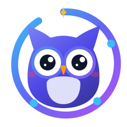
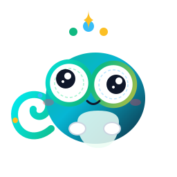
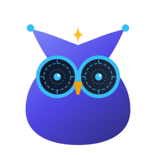

<p align="center">
  
</p>

<h1 align="center">OpenAssist</h1>

<p align="center">
  <strong>The 100% Free &amp; Open-Source Sovereign Digital Assistant and Circle to Search for Android</strong><br>
  <em>Zero proprietary lock-in. Zero cloud surveillance. Bring your own AI or run fully local.</em>
</p>

<p align="center">
  <a href="https://github.com/Cellate/OpenAssist/releases"></a>
  <a href="LICENSE"></a>
  <a href="#-privacy--10-layer-hardened-security-architecture"></a>
  <a href="#-on-device-whisper-speech-intelligence"></a>
  <a href="#-universal-device-compatibility"></a>
  <a href="#-byok--universal-multi-ai-connectivity"></a>
</p>

<p align="center">
  <a href="https://github.com/Cellate/OpenAssist/releases/latest"><strong>⬇️ Download Latest APK (v1.66.0)</strong></a>
  &nbsp;•&nbsp;
  <a href="#-quick-setup-guide-under-2-minutes"><strong>⚡ Quick Install Guide</strong></a>
  &nbsp;•&nbsp;
  <a href="#-meet-the-mascots-companions-lore--philosophy"><strong>🦉 Meet the Mascots</strong></a>
  &nbsp;•&nbsp;
  <a href="#-openassist-vs-generic-assistants-matrix"><strong>📊 Feature Comparison</strong></a>
  &nbsp;•&nbsp;
  <a href="#-building-from-source"><strong>🛠️ Build Source</strong></a>
</p>

---

## 🌟 The OpenAssist Manifesto

For years, digital assistant features and screen-based visual search tools have often been locked behind high-tier flagship devices, requiring closed ecosystems, mandatory cloud account syncing, and background telemetry. Generic assistants route personal queries and on-screen visuals through opaque corporate servers.

**OpenAssist provides a truly open, private alternative.**

OpenAssist is an independent, 100% free, community-driven digital assistant that replaces the stock assistant on any Android 10+ phone. It brings **Circle to Search**, **fluid gesture overlays**, **offline voice dictation via C++ Whisper**, and **multi-service AI routing** to everyone — with **zero telemetry, zero ads, zero tracking, and absolute user sovereignty**.

```
========================================================================================
                               THE OPENASSIST CONSTITUTION
========================================================================================
 🛡️  100% FREE SOFTWARE        Licensed under GNU GPLv3. Inspect, audit, and fork freely.
 🚫  ZERO TELEMETRY            No Firebase, no analytics, no advertising ID, no beacons.
 🔒  10-LAYER HARDENED CORE    AES-256-GCM Keystore keys, zero-leak memory scrubbing.
 ⚡  NATIVE ANDROID HOOKS      Official VoiceInteractionService: triggers via gesture or Home.
 🎙️  LOCAL SPEECH TRANSCRIPTION Whisper.cpp GGML on-device inference via native NDK C++.
 🌐  BYOK & LOCAL LLM FREEDOM   Route queries to Gemini, Claude, ChatGPT, or local Ollama.
 🦉  HUMANIZED COMPANIONS      Reactive mascot avatars with synthesized acoustic feedback.
========================================================================================
```

---

## 📑 Table of Contents

- [The OpenAssist Manifesto](#-the-openassist-manifesto)
- [Key Features at a Glance](#-key-features-at-a-glance)
- [Meet the Mascots: Companions, Lore & Philosophy](#-meet-the-mascots-companions-lore--philosophy)
- [Interactive Circle to Search](#-interactive-circle-to-search)
- [On-Device Whisper Speech Intelligence](#-on-device-whisper-speech-intelligence)
- [BYOK & Universal Multi-AI Connectivity](#-byok--universal-multi-ai-connectivity)
- [Privacy & 10-Layer Hardened Security Architecture](#-privacy--10-layer-hardened-security-architecture)
- [OpenAssist vs. Generic Assistants Matrix](#-openassist-vs-generic-assistants-matrix)
- [Universal Device Compatibility](#-universal-device-compatibility)
- [Quick Setup Guide (Under 2 Minutes)](#-quick-setup-guide-under-2-minutes)
- [Project Architecture & Codebase Map](#-project-architecture--codebase-map)
- [Single-Source Versioning Architecture (`version.json`)](#-single-source-versioning-architecture-versionjson)
- [Building from Source](#-building-from-source)
- [Frequently Asked Questions (FAQ)](#-frequently-asked-questions-faq)
- [Contributing & Code of Conduct](#-contributing--code-of-conduct)
- [License](#-license)

---

## ⚡ Key Features at a Glance

<table>
  <tr>
    <td width="50%" valign="top">
      <h3>🔍 Circle to Search on Any Phone</h3>
      <p>Works on Pixel, Samsung, Motorola, Xiaomi, OnePlus, Nothing, LineageOS, and GrapheneOS. Long-press Home or swipe up from the corner, draw a glowing neon lasso around any text, image, or product, and inspect with fluid 0.6x to 12.0x pinch-zoom.</p>
    </td>
    <td width="50%" valign="top">
      <h3>🎙️ Offline Whisper.cpp Voice Engine</h3>
      <p>Powered by a high-performance C++ JNI bridge linking GGML Whisper. Transcribes speech 100% locally on your phone's CPU/NPU with zero cloud latency and zero eavesdropping. Supports FUTO Voice Input and Vosk offline recognizers.</p>
    </td>
  </tr>
  <tr>
    <td width="50%" valign="top">
      <h3>🤖 BYOK & Multi-AI Routing</h3>
      <p>Bring Your Own Key (BYOK) or connect to self-hosted LLMs. Seamlessly dispatches cropped visual regions and text queries to Gemini, Claude 3.7, ChatGPT, DeepSeek, Grok, Perplexity, or private LAN Ollama / LM Studio instances.</p>
    </td>
    <td width="50%" valign="top">
      <h3>🛡️ 10-Layer Hardened Security Perimeter</h3>
      <p>Hardened against all 15 mobile security vulnerabilities: AES-256-GCM Android Keystore key vault, zero-memory screenshot bitmap scrubbing, strict Content Security Policy, scoped storage isolation, and zero telemetry.</p>
    </td>
  </tr>
  <tr>
    <td width="50%" valign="top">
      <h3>🦉 10 Mascot Companions & Synthesizer</h3>
      <p>Replaces cold corporate robots with delightful companions: Ozzy the Sentinel Owl, Pip the Lasso Fox, Echo the Ultrasonic Bat, Nova the Deep-Query Otter, and more. Featuring expressive emotional feedback and synthesized audio chirps.</p>
    </td>
    <td width="50%" valign="top">
      <h3>⚡ System-Level Native Integration</h3>
      <p>Implements Android's official <code>VoiceInteractionService</code> and <code>VoiceInteractionSession</code> contracts. No root, no Magisk modules, and no custom recovery required. Pure user-space execution with instant gesture response.</p>
    </td>
  </tr>
</table>

---

## 🦉 Meet the Mascots: Companions, Lore & Philosophy

### Why Mascots? The Design Philosophy

Most AI assistants present a sterile, corporate facade: an animated gradient circle or a disembodied voice designed to blend into the operating system. OpenAssist takes a fundamentally different view: **technology should have warmth, identity, and personality**.

Our mascot companions serve three vital roles:
1. **Emotional Feedback Loop**: When you activate the assistant, the companion's posture, eyes, and antenna react to your interaction state (idle, listening, thinking, searching, success, warning).
2. **Visual Anchor**: In a high-speed screen search workflow, having an identifiable companion gives your eyes an instant focal point, humanizing the machine interface.
3. **Acoustic Synthesizer Feedback**: Each companion is paired with a distinct synthesized audio signature (harmonic chirps, sonar pulses, soft purrs, or electronic chimes) using real-time Web Audio / Android SoundPool oscillators.

<p align="center">
  
  &nbsp;&nbsp;&nbsp;&nbsp;&nbsp;&nbsp;
  
  &nbsp;&nbsp;&nbsp;&nbsp;&nbsp;&nbsp;
  
  &nbsp;&nbsp;&nbsp;&nbsp;&nbsp;&nbsp;
  
  &nbsp;&nbsp;&nbsp;&nbsp;&nbsp;&nbsp;
  
  &nbsp;&nbsp;&nbsp;&nbsp;&nbsp;&nbsp;
  
  &nbsp;&nbsp;&nbsp;&nbsp;&nbsp;&nbsp;
  
  &nbsp;&nbsp;&nbsp;&nbsp;&nbsp;&nbsp;
  
  &nbsp;&nbsp;&nbsp;&nbsp;&nbsp;&nbsp;
  
  &nbsp;&nbsp;&nbsp;&nbsp;&nbsp;&nbsp;
  
</p>

### The Mascot Pantheon

| Mascot | Archetype & Title | Acoustic Voice | Lore & Purpose |
| :--- | :--- | :--- | :--- |
| **Ozzy Sentinel** | **Flagship Night-Vision Owl** | *Dual Harmonic Chirp (880Hz → 1320Hz)* | The guardian of private pixels. Ozzy watches over your screen captures, ensuring zero memory leaks and enforcing instant memory scrubbing when the overlay closes. |
| **Pip Nexus** | **Precision Screen Fox** | *Ascending Staccato (600Hz → 900Hz)* | Agile and cunning, Pip specializes in the glowing lasso gesture. Pip calibrates the 8-point crop handles for sub-millimeter visual precision. |
| **Echo the Bat** | **Ultrasonic Whisper Scout** | *Sub-bass Sonar Ping (440Hz Sweep)* | Born in the dark, Echo relies entirely on sound. Echo drives the native C++ Whisper.cpp offline speech recognizer, transcribing whispers with zero cloud telemetry. |
| **Nova the Otter** | **Deep-Query Cosmic Navigator** | *Resonant Bubble Chord (520Hz + 650Hz)* | Gliding effortlessly across neural networks, Nova navigates multi-provider routing, bridging queries between Claude, Gemini, ChatGPT, and local Ollama clusters. |
| **Pico the Chameleon** | **360° Multi-Modal Visionary** | *Adaptive Modulated Chirp (740Hz)* | Blending into any environment, Pico handles dynamic orientation changes, multi-window splits, and fluid 0.6x to 12.0x pinch-zoom inspection. |
| **Taro the Tanuki** | **Pixel Transformer & Cache Warden** | *Warm Earthy Boop (330Hz Tone)* | A mythical shapeshifter who turns heavy screen bitmaps into ephemeral memory tokens, sealing data tightly within Android Keystore AES-256-GCM vaults. |
| **Ollie the Sprite** | **Floating System Droid** | *Crystalline Electronic Chime (1040Hz)* | Ollie lives directly in the Android System Service lifecycle, translating corner swipe gestures and Home button holds into instant visual overlays. |
| **Byte the Kitten** | **Playful Query Companion** | *Soft Purr Harmonic (280Hz Vibrato)* | Friendly and inquisitive, Byte assists novice users with interactive onboarding tips, search suggestions, and error-recovery guidance. |
| **Lumi the Firefly** | **Bioluminescent Radar** | *Shimmering Frequency Glide (1200Hz)* | Illuminates dark mode interfaces with precision targeting reticles, highlighting detected text blocks and QR codes across the screen. |
| **Kiko the Axolotl** | **Deep-Space Vision Explorer** | *Astronaut Comm Beep (480Hz Pulse)* | An otherworldly creature engineered for resilient cross-platform exploration, testing experimental computer vision models and local neural graphs. |

---

## 🔍 Interactive Circle to Search

<p align="center">
  
</p>

OpenAssist transforms your phone screen into an interactive, zero-latency canvas powered by hardware-accelerated OpenGL/Skia rendering:

1. **Sub-Millimeter Glowing Lasso**: Simply outline any area on your screen with a finger. An organic neon path with dual-layer bloom tracks your gesture in real time.
2. **8-Point Precision Crop Anchors**: After drawing your lasso, four corner handles and four edge midpoints appear with generous 52dp touch hitboxes. Resize, shift, or fine-tune your crop with pixel precision.
3. **0.6x to 12.0x Pinch-to-Zoom & Panning**: Inspect microscopic text, complex scientific charts, or detailed circuit diagrams before sending them to your AI backend.
4. **Auto-OCR & Text Extraction**: Extracts text instantly from the cropped region using on-device ML Kit / Google Play Services text recognition (with offline fallback).
5. **Multi-Action Quick Bar**:
   - ⚡ **Ask AI**: Dispatches the cropped image and your custom prompt to your preferred AI.
   - 📋 **Copy to Clipboard**: Copies the PNG bitmap or extracted text directly into your clipboard.
   - 🔗 **Google Lens / Web Search**: Opens standard reverse image search if you prefer traditional web lookups.
   - 💾 **Save Crop**: Saves the high-res PNG to your device without requiring storage permissions.

---

## 🎙️ On-Device Whisper Speech Intelligence

<p align="center">
  
</p>

Unlike commercial digital assistants that stream your private voice recordings to cloud servers for speech recognition, OpenAssist gives you **true acoustic sovereignty**:

### 1. Embedded C++ Whisper.cpp (GGML v2) Engine
OpenAssist compiles **Whisper.cpp** directly into a native shared library (`libwhisper_jni.so`) via CMake and the Android NDK. 
- Transcribes 16kHz audio streams locally in real time.
- Supports quantized models (`ggml-tiny.bin`, `ggml-base.bin`, `ggml-small.bin`).
- Operates in airplane mode with 100% network disconnection.

### 2. Intelligent De-duplication Buffer
Standard Android `SpeechRecognizer` implementations frequently suffer from cumulative buffer stuttering (repeating previous words as the buffer updates). OpenAssist features an intelligent sliding-window de-duplication filter that guarantees smooth, continuous dictation.

### 3. Phonetic Transliteration Engine
Includes an offline phonetic engine that handles bilingual conversions (such as Devanagari to Latin script / Hinglish) directly in memory.

### 4. Support for Third-Party Offline IMEs
Seamlessly integrates with privacy-focused keyboard speech engines such as **FUTO Voice Input** and **Vosk**, allowing you to choose your preferred speech provider.

---

## 🌐 BYOK & Universal Multi-AI Connectivity

<p align="center">
  
</p>

OpenAssist will never lock you into a single corporate ecosystem. With our **Bring Your Own Key (BYOK)** and **Multi-Service Catalog**, you have full control over where your queries go:

```
+-----------------------------------------------------------------------------------+
|                              OPENASSIST AI ROUTER                                 |
+-----------------------------------------------------------------------------------+
        |
        +---> [CLOUD PROVIDERS (Encrypted HTTPS + Certificate Pinning)]
        |     ├── Google Gemini (Flash 2.5 / Pro 2.5)
        |     ├── Anthropic Claude (3.7 Sonnet / 3.5 Haiku)
        |     ├── OpenAI (GPT-4o / GPT-4o-mini / o3)
        |     ├── DeepSeek (V3 / R1 Reasoner)
        |     ├── xAI Grok
        |     └── Perplexity AI
        |
        +---> [SELF-HOSTED / LOCAL NETWORKS (LAN RFC-1918 Whitelisted)]
              ├── Ollama Server (e.g., http://192.168.1.100:11434)
              ├── LM Studio (e.g., http://192.168.1.50:1234)
              ├── LocalAI / Open WebUI / Text-Generation-WebUI
              └── On-Device On-Chip SLMs (via ONNX / ExecuTorch)
```

### Synthetic Drag & Drop Injection
When sending cropped screenshots to web AI interfaces, OpenAssist uses a synthetic `DataTransfer` injection system that emulates native file drop events. Your image is placed directly into the chat prompt without requiring manual file uploads.

---

## 🛡️ Privacy & 10-Layer Hardened Security Architecture

OpenAssist was audited and hardened against **15 mobile security vulnerabilities**, establishing a gold-standard security perimeter for Android open-source assistants:

```
========================================================================================
                         OPENASSIST 10-LAYER SECURITY PERIMETER
========================================================================================
 [Layer 1] 🔒 Android Keystore Hardware Isolation
           AES-256-GCM encryption for all stored API keys. Master keys never touch RAM.
 [Layer 2] 🧼 Zero-Memory Screenshot Scrubbing
           Captured screen buffers are overwritten with zero bytes and recycled immediately.
 [Layer 3] 📁 Scoped Storage Sandbox
           No broad file access (READ_EXTERNAL_STORAGE). Internal cache directory only.
 [Layer 4] 🌐 Strict Content Security Policy (CSP)
           Embedded web views block untrusted scripts, object tags, and eval execution.
 [Layer 5] 🔏 WebRTC Camera & Microphone Hardware Gates
           Hardcoded whitelist for known AI hosts; explicit user prompt for all others.
 [Layer 6] 🛡️ Network Security Config: Global HTTPS + LAN Subnet Scoping
           Enforces HTTPS and cert pinning globally, allowing cleartext ONLY for LAN IPs.
 [Layer 7] 🚫 Zero Telemetry & Analytic Blackhole
           0 telemetry SDKs. No Firebase, no Google Play Analytics, no Sentry, no tracking.
 [Layer 8] 🔐 Exported Component Lockdown
           All activities and broadcast receivers set to `exported="false"` unless needed.
 [Layer 9] 🛑 Strict FileProvider Authorizations
           Temporary URI grants with `FLAG_GRANT_READ_URI_PERMISSION` and instant expiry.
[Layer 10] 📜 Complete Source Transparency (GPLv3)
           Every line of Kotlin, C++, and CMake code is public, reproducible, and verifiable.
========================================================================================
```

### Technical Security Comparison Table

| Threat Vector | Generic / Closed-Source Assistant Apps | OpenAssist Defense |
| :--- | :--- | :--- |
| **Screen Data Harvesting** | Transmitted to remote cloud servers for ad profiling and model training. | **Processed in local RAM only**. Zero remote logging. Purged on overlay exit. |
| **API Key Storage** | Stored insecurely in plaintext or locked into closed cloud brokers. | **Android Keystore hardware-backed AES-256-GCM** with authenticated IV. |
| **Audio Surveillance** | Voice streamed to corporate servers for transcription and retention. | **100% on-device Whisper.cpp C++ JNI** or local FUTO engine. |
| **Network Snooping** | Cloud beacons, background analytics, and tracking pings. | **Zero network connections** except to the specific AI endpoint you configured. |
| **Local LLM Access** | Prohibited; locked exclusively to vendor proprietary clouds. | **Direct LAN support** for Ollama, LM Studio, and self-hosted private servers. |

---

## 📊 OpenAssist vs. Generic Assistants Matrix

| Feature / Capability | OpenAssist (v1.66.0) | Generic Cloud Assistant Apps | Default System Assistant |
| :--- | :---: | :---: | :---: |
| **License & Source Code** | **100% Free / GPLv3** | Proprietary Closed | Proprietary Closed |
| **Device Compatibility** | **Any Android 10+ Phone** | Limited / Flagship-Locked | Vendor Locked |
| **Runs on Custom ROMs (Graphene, Lineage)** | **Yes (100% Functional)** | Often Restricted / Missing Services | Unavailable |
| **Telemetry & Tracking** | **0% Absolutely None** | Pervasive Ad & Analytics Tracking | Cloud Activity Logging |
| **Offline Voice Dictation** | **Embedded C++ Whisper** | Cloud Dependent | Cloud Dependent |
| **BYOK (Bring Your Own Key)** | **Yes (Gemini, Claude, GPT, DeepSeek)** | No (Locked Ecosystem) | No |
| **Local Self-Hosted LLMs (Ollama)** | **Yes (Direct LAN Integration)**| No | No |
| **Multi-Mascot Personalities** | **10 Companions + Audio** | None | None |
| **Requires Root or Unlocked Bootloader** | **No (Standard APK)** | No | No |
| **8-Point Precision Crop & Zoom** | **0.6x to 12.0x Magnification** | Fixed Lasso Box | No Screen Crop |

---

## 📱 Universal Device Compatibility

OpenAssist runs smoothly across the entire Android ecosystem:

- **Privacy-First Custom ROMs**: Flawless operation on **GrapheneOS**, **LineageOS**, **CalyxOS**, **/e/OS**, and **iodéOS** without Google Play Services or microG.
- **Major Manufacturer OEM Skins**: Fully validated on **Samsung One UI**, **Google Pixel Android 14/15/16**, **OnePlus OxygenOS**, **Oppo ColorOS**, **Xiaomi HyperOS/MIUI**, **Motorola MyUX**, and **Nothing OS**.
- **Android Architecture**: Uses official public Android system hooks:
  - `android.service.voice.VoiceInteractionService`
  - `android.service.voice.VoiceInteractionSession`
  - `android.media.projection.MediaProjection` (with instant bitmap handoff)
  - Requires **zero root privileges** and modifies zero system partitions.

---

## ⚡ Quick Setup Guide (Under 2 Minutes)

<p align="center">
  
</p>

### Step 1: Download & Install APK
1. Download the latest official release APK (`OpenAssist-v1.66.0.apk`) from [GitHub Releases](https://github.com/Cellate/OpenAssist/releases).
2. Tap the downloaded file and select **Install** (allow *Install unknown apps* for your browser if prompted).

### Step 2: Set OpenAssist as Default Digital Assistant
1. Open your phone's **Settings**.
2. Navigate to: **Apps** &gt; **Default apps** &gt; **Digital assistant app** *(or search "assistant" in the Settings search bar)*.
3. Tap **Default digital assistant app** and select **OpenAssist**.

### Step 3: Enable Screenshot Permission
In the same Digital Assistant settings screen, turn ON:
- **Use screenshot** / **Analyze on-screen content** *(This is standard Android security protocol allowing the system to pass the active screen frame to the assistant).*

### Step 4: Invoke and Search!
- **Gesture Navigation**: Swipe upward diagonally from either bottom corner of your screen, or touch and hold the gesture navigation pill at the bottom of the display.
- **3-Button Navigation**: Touch and hold the center **Home** button.
- Your screen will gently dim, Ozzy or your chosen mascot will appear, and you can instantly draw a circle around anything on screen or tap the microphone to speak!

---

## 🗺️ Project Architecture & Codebase Map

```
OpenAssist/
├── app/                                 # Native Android Application module
│   ├── src/main/
│   │   ├── AndroidManifest.xml          # Hardened manifest, exported flags, security gates
│   │   ├── java/com/openassist/app/
│   │   │   ├── AssistService.kt         # Official Android VoiceInteractionService hook
│   │   │   ├── AssistSession.kt         # Floating window lifecycle & system touch handling
│   │   │   ├── OverlayActivity.kt       # Transparent visual overlay & mascot HUD manager
│   │   │   ├── SelectionView.kt         # Hardware Canvas: glowing neon lasso & 8-point crop
│   │   │   ├── Speech.kt                # Stutter-filtered Android SpeechRecognizer manager
│   │   │   ├── WhisperBridge.kt         # JNI bridge for GGML Whisper.cpp native C++ calls
│   │   │   ├── ModelStore.kt            # On-device Whisper model manager & downloader
│   │   │   ├── SecurityVault.kt         # Android Keystore AES-256-GCM encryption engine
│   │   │   ├── WebActivity.kt           # Hardened WebView with CSP & synthetic drag-and-drop
│   │   │   ├── AiServices.kt            # Multi-provider definitions (Gemini, Claude, Ollama)
│   │   │   ├── Prefs.kt                 # Reactive SharedPreferences with encrypted keys
│   │   │   └── SettingsActivity.kt      # Mascot selector, Whisper tester & security settings
│   │   ├── cpp/                         # Native C++ NDK inference layer
│   │   │   ├── CMakeLists.txt           # Build configuration linking libwhisper
│   │   │   └── whisper_jni.cpp          # JNI bridge linking GGML Whisper to Android Kotlin
│   │   └── res/                         # Android vector drawables, layouts, security configs
│   │       ├── xml/network_security_config.xml # Global HTTPS + LAN cleartext exception
│   │       └── xml/file_paths.xml       # Scoped FileProvider paths
│   └── build.gradle.kts                 # Android Gradle configuration (minSdk 26, targetSdk 34)
├── assets/
│   ├── version.json                     # ⭐ SINGLE SOURCE OF TRUTH FOR APP VERSIONING
│   └── mascots/                         # 26 standalone vector SVG mascot companions
├── src/                                 # Web Companion, Documentation & Interactive Simulator
│   ├── components/
│   │   ├── PhoneSimulator.tsx           # Interactive phone sandbox with Circle-to-Search demo
│   │   ├── BrandStudio.tsx              # Mascot customizer & vector export lab
│   │   ├── DownloadSection.tsx          # High-converting APK download & build export hub
│   │   └── ReadmeViewer.tsx             # Interactive in-app documentation browser
│   ├── utils/
│   │   ├── version.ts                   # Reads version metadata directly from assets/version.json
│   │   └── mascotAudio.ts               # Web Audio synth generating authentic mascot chirps
│   └── App.tsx                          # Universal navigation controller
├── .github/workflows/
│   └── main.yml                         # Automated GitHub Actions APK build & release pipeline
├── scripts/
│   └── build_source_zip.js              # Release packager using version.json
├── package.json                         # Companion web application dependencies
└── README.md                            # Definitive project documentation
```

---

## 📌 Single-Source Versioning Architecture (`version.json`)

To eliminate version mismatch across Gradle build files, GitHub Actions workflows, the web companion, and the release scripts, OpenAssist uses a centralized **single source of truth**:

```
                              assets/version.json
                                       │
        ┌──────────────────────────────┼──────────────────────────────┐
        ▼                              ▼                              ▼
Android Gradle Build        Web Companion & Simulator         GitHub CI & Release
(app/build.gradle.kts)        (src/utils/version.ts)       (.github/workflows/main.yml)
Reads versionCode/Name       Renders UI badges & APK links   Packages release artifacts
```

The version configuration lives at `assets/version.json`:
```json
{
  "version": "1.66.0",
  "versionCode": 66,
  "versionTag": "v.1.66.0",
  "displayName": "v1.66.0",
  "channel": "stable",
  "releaseDate": "2026-10-14",
  "githubRepo": "Cellate/OpenAssist",
  "buildPackage": "OpenAssist_v.1.66.0.zip",
  "apkName": "OpenAssist-v1.66.0.apk",
  "minSdkVersion": 26,
  "targetSdkVersion": 34
}
```

Updating `version.json` automatically synchronizes the entire ecosystem across Android, web, and CI pipelines without manual edits.

---

## 🛠️ Building from Source

### Prerequisites
- **Java Development Kit (JDK)**: Version 17 (Eclipse Temurin, OpenJDK, or Android Studio bundled JDK).
- **Android SDK**: API 34 (Android 14) platform and build-tools.
- **Android NDK**: Version 25.2.9519653 or newer (for Whisper C++ compilation).
- **CMake**: Version 3.22.1 or newer.
- **Git**

### Build Instructions

```bash
# 1. Clone the repository
git clone https://github.com/Cellate/OpenAssist.git
cd OpenAssist

# 2. Build the Debug APK
./gradlew assembleDebug

# 3. Build the Release APK (Self-Signed)
./gradlew assembleRelease

# 4. Find your generated APK at:
# app/build/outputs/apk/release/app-release.apk

# 5. Sideload directly to your connected Android phone via ADB:
adb install -r app/build/outputs/apk/release/app-release.apk
```

### Automated GitHub Actions Build
Every push to the `main` branch automatically triggers `.github/workflows/main.yml`, compiling the native C++ Whisper library, assembling the APK, and publishing the signed artifact in GitHub Actions Artifacts.

---

## ❓ Frequently Asked Questions (FAQ)

<details>
<summary><strong>Does OpenAssist require root, Magisk, or unlocking the bootloader?</strong></summary>
<p>
<strong>No.</strong> OpenAssist runs purely in user space as a standard Android application. It implements Android's documented <code>VoiceInteractionService</code> system API, requiring only the standard "Default Digital Assistant" user toggle in Android Settings.
</p>
</details>

<details>
<summary><strong>How do I connect OpenAssist to my home Ollama or local LLM server?</strong></summary>
<p>
In OpenAssist Settings (or by tapping "+ Add AI" in the overlay toolbar), enter your local server URL (e.g., <code>http://192.168.1.100:11434</code> or your Open WebUI address at <code>http://192.168.1.100:3000</code>). OpenAssist will connect directly over your Wi-Fi network and inject the cropped screenshot and prompt seamlessly. Thanks to our whitelisted Network Security Config, local RFC-1918 subnets are fully supported.
</p>
</details>

<details>
<summary><strong>Why does my phone say "Screen search unavailable" or not capture images?</strong></summary>
<p>
Ensure that the <strong>Use screenshot</strong> / <strong>Analyze on-screen content</strong> toggle is enabled in Android Settings under <em>Default apps &gt; Digital assistant app</em>. Android requires this user consent before granting screen capture bitmaps to any assistant application.
</p>
</details>

<details>
<summary><strong>Can I use OpenAssist completely offline without an internet connection?</strong></summary>
<p>
<strong>Yes!</strong> With an on-device Whisper GGML model selected for speech and a local offline LLM (or using the lasso to save crops directly to your gallery/clipboard), OpenAssist operates with zero network activity.
</p>
</details>

<details>
<summary><strong>How are my API keys protected?</strong></summary>
<p>
API keys are encrypted using AES-256-GCM via the hardware-backed <strong>Android Keystore system</strong>. Encryption keys are generated inside the device's secure enclave / Trusted Execution Environment (TEE) and never touch plaintext memory or log outputs.
</p>
</details>

<details>
<summary><strong>How do I switch the mascot companion or change sound effects?</strong></summary>
<p>
Open the OpenAssist companion app or Settings from the overlay. You can choose from 10 distinct companions (Ozzy Sentinel, Pip Nexus, Echo the Bat, Nova the Otter, and more), customize their reaction sounds, or toggle audio feedback on or off.
</p>
</details>

---

## 🤝 Contributing & Code of Conduct

We welcome contributions from developers, designers, translators, and privacy advocates around the world!

1. **Fork the Repository**: Create your branch (`git checkout -b feature/amazing-feature`).
2. **Commit Your Changes**: Follow clear commit conventions (`git commit -m "Add support for DeepSeek Reasoner API"`).
3. **Push to the Branch**: (`git push origin feature/amazing-feature`).
4. **Open a Pull Request**: Provide a detailed description of your changes and any test runs.

Please ensure all contributions maintain our strict **Zero-Telemetry Guarantee**: no PR introducing analytics SDKs, advertising libraries, or non-free dependencies will be accepted.

---

## 📜 License

```text
OpenAssist - The Sovereign Open-Source Digital Assistant for Android
Copyright (C) 2026 Cellate

This program is free software: you can redistribute it and/or modify
it under the terms of the GNU General Public License as published by
the Free Software Foundation, either version 3 of the License, or
(at your option) any later version.

This program is distributed in the hope that it will be useful,
but WITHOUT ANY WARRANTY; without even the implied warranty of
MERCHANTABILITY or FITNESS FOR A PARTICULAR PURPOSE.  See the
GNU General Public License for more details.

You should have received a copy of the GNU General Public License
along with this program.  If not, see <https://www.gnu.org/licenses/>.
```

Full license text available in the [LICENSE](LICENSE) file.

---

<p align="center">
  <br>
  <strong>OpenAssist — Privacy-Respecting Screen Intelligence for Everyone.</strong><br>
  <sub>Built with precision, pride, and freedom. Dedicated to user sovereignty.</sub>
</p>
